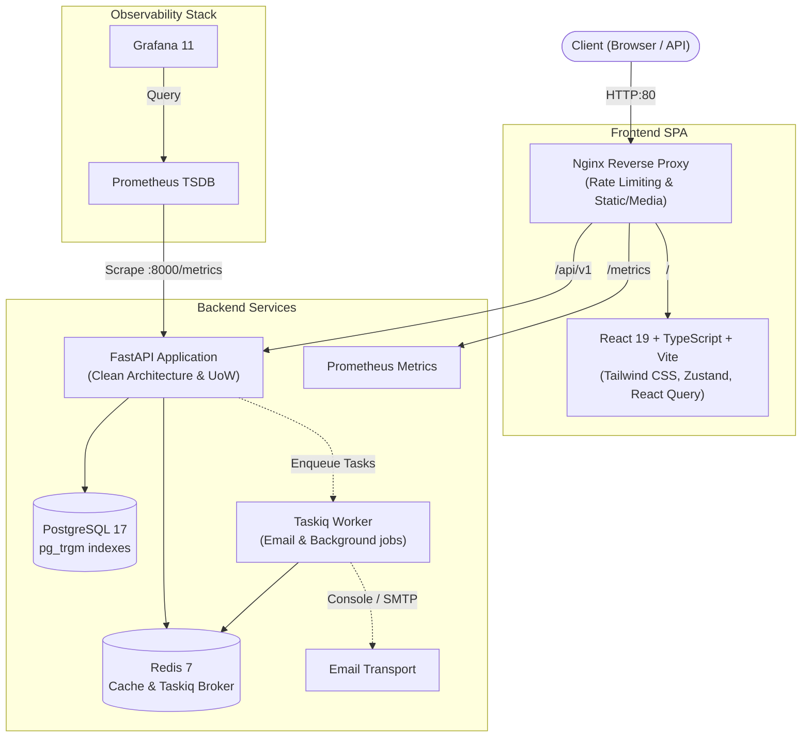

# Shopperflox

<div align="center">

**Modern Marketplace Platform for Creator Brands, Independent Artisans, and Shoppers**

[](https://www.python.org/)
[](https://fastapi.tiangolo.com/)
[](https://react.dev/)
[](https://docs.docker.com/compose/)
[](LICENSE)

**English** | [Русский](README-ru.md)

</div>

---

## 📖 About the Project

**Shopperflox** is a full-featured, scalable e-commerce ecosystem designed for creator brands, independent artisans, and shoppers. The platform supports the complete marketplace lifecycle: from product publication with pre-moderation to order assembly queues, multi-currency pricing (RUB / CNY), postal logistics networks, and payment gateway integration.

### Key Features

- 🛍️ **Product Catalog & Variations**: Multi-attribute variants (sizes, colors, stock counts), collection & brand grouping, draggable gallery reordering, and limited-edition badges (`is_limited`).
- 🎨 **Brand & Artisan Studio**: Brand creation, multi-user member management with granular role assignment (`creator:brand`), and logo/branding upload.
- ⚖️ **Pre-moderation System**: Product review pipeline (Draft -> Pending Moderation -> Approved / Rejected with reason), preventing unverified content from entering the public storefront.
- 📦 **Order Fulfillment & Logistics**:
  - Flexible shipping modes: post offices / pickup points, courier delivery, and local pickup.
  - Post offices directory with dedicated access control for postal managers (`mod:mail-manager`).
  - Passport and identity document management for customs declaration and international shipping.
  - Order fulfillment pipeline with status tracking: `pending`, `paid`, `in_production`, `dispatched`, `in_transit`, `ready_for_pickup`, `delivered`, `returning`, `returned`, `cancelled`.
- 💳 **Multi-currency & Payments**: Prices in Russian Rubles (RUB) and Chinese Yuan (CNY) with real-time conversion; built-in debug payment mode (`debug_pay`) for local testing and production billing gateway support (`BILLING_ENABLED`).
- 🔐 **Enterprise-Grade Security**:
  - Asymmetric authentication using **EdDSA (Ed25519)** with public key verification.
  - Password hashing with **Argon2id** and a secret system pepper.
  - Real-time token revocation and blacklist in Redis upon permission modification or password change.
  - Hierarchical RBAC: Superuser (`*`), Admins (`admin:access`), Catalog Moderators (`mod:approve_manager`), Mail Managers (`mod:mail-manager`).
- ⚡ **Background Processing & SMTPless Mode**: Asynchronous task execution using **Taskiq + Redis** for email dispatch and verification codes. In development mode, no external SMTP server is required — all codes and passwords are automatically routed to worker logs.
- 📊 **Observability & Metrics**: Built-in Prometheus metrics endpoint (`/metrics`), pre-configured Grafana dashboards, and liveness/readiness healthchecks (`/health/live`, `/health/ready`).

---

## 🏛️ System Architecture



---

## 🛠️ Tech Stack

| Domain | Technologies |
|---|---|
| **Backend** | Python 3.13, FastAPI, SQLAlchemy 2.0 (asyncio), Asyncpg, Alembic, Pydantic v2 |
| **Queues & Background Tasks** | Taskiq, Taskiq-Redis, Redis 7 |
| **Database** | PostgreSQL 17 (with `pg_trgm` extension for fast fuzzy search) |
| **Security** | Ed25519 (EdDSA JWT via PyJWT & Cryptography), Argon2id (pwdlib) |
| **Frontend** | React 19, TypeScript, Vite, Tailwind CSS, TanStack React Query v5, Zustand |
| **Infrastructure** | Docker, Docker Compose, Nginx 1.27 Alpine |
| **Monitoring** | Prometheus 2.54, Grafana 11.2, Loguru |
| **Package Managers** | `uv` (Python), `npm` (Node.js) |

---

## 🚀 Quick Start

### Prerequisites

- **Docker** and **Docker Compose** (v2 / Compose CLI)
- **Python >= 3.13** and the **[uv](https://docs.astral.sh/uv/)** package manager

---

### Step-by-Step Setup

#### 1. Sync Dependencies and Generate Configuration (.env)

Navigate to the `backend` directory, synchronize the environment, and generate cryptographic keys, database credentials, and admin passwords:

```bash
cd backend
uv sync
uv run get_env.py
```

> [!TIP]
> The `get_env.py` utility automatically generates an Ed25519 keypair for JWT, a strong pepper for Argon2, PostgreSQL and Grafana credentials, and copies the generated file to the root `.env`.
> For unattended/non-interactive execution, pass `--auto`:
> ```bash
> uv run get_env.py --auto
> ```

Return to the repository root:
```bash
cd ..
```

---

#### 2. Build and Start Services in Docker

Start all platform services (Nginx, Frontend, Backend, Taskiq Worker, PostgreSQL, Redis, Prometheus, Grafana) in detached mode:

```bash
docker-compose up -d --build
```

---

#### 3. Run Database Migrations

Apply database schema migrations via Alembic:

```bash
docker-compose exec backend alembic upgrade head
```

*(or directly via the container name)*:
```bash
docker exec shopperflox-backend alembic upgrade head
```

---

#### 4. SMTPless Mode (Obtaining Passwords & Verification Codes)

By default, the platform runs in `EMAIL_BACKEND=console` mode. All outgoing emails (verification codes, password reset links, generated credentials) are output directly to the Taskiq worker logs.

To view dispatched codes or passwords:

```bash
# View the latest message:
docker-compose logs worker --tail 1

# View the last 5 lines (or by container name):
docker logs shopperflox-worker --tail 5
```

---

#### 5. Stop and Wipe Project Resources in Docker

To completely stop all running containers, remove persistent volumes, and clean up built images:

```bash
docker-compose down -v --rmi all
```

---

## 🌐 Network Ports & Service Access

Once running, the following services are accessible locally:

| Service | URL | Purpose |
|---|---|---|
| **Web Storefront (Frontend)** | [http://localhost](http://localhost) | Catalog, shopping cart, checkout, profile, admin panel |
| **REST API & Swagger UI** | [http://localhost/docs](http://localhost/docs) | Interactive OpenAPI documentation |
| **ReDoc API Documentation** | [http://localhost/redoc](http://localhost/redoc) | Alternative API reference |
| **Healthcheck (Live)** | [http://localhost/health/live](http://localhost/health/live) | Liveness probe endpoint |
| **Prometheus Metrics** | [http://localhost/metrics](http://localhost/metrics) | Backend Prometheus metrics exporter |
| **Grafana Dashboards** | [http://localhost:3000](http://localhost:3000) | Observability dashboards (credentials from `.env`) |
| **Prometheus Web UI** | [http://localhost:9090](http://localhost:9090) | Prometheus TSDB console |

---

## ⚙️ Environment Variables

The `.env` file is generated by `backend/get_env.py` (templates available in [`.env.example`](.env.example) and [`backend/.env.example`](backend/.env.example)):

| Variable | Description | Default |
|---|---|---|
| `APP_ENV` | Application environment (`dev`, `test`, `production`) | `dev` |
| `DEBUG` | Debug mode (strictly prohibited when `APP_ENV=production`) | `True` |
| `DATABASE_URL` / `DB_URL` | PostgreSQL asyncpg connection string | Auto-generated |
| `REDIS_URL` | Redis connection string | `redis://localhost:6379/0` |
| `JWT_ALGORITHM` | Algorithm used for JWT signing | `EdDSA` |
| `JWT_PRIVATE_KEY` | Hex-encoded Ed25519 private seed (32 bytes) | Auto-generated |
| `JWT_PUBLIC_KEY` | Hex-encoded Ed25519 public key | Derived |
| `PEPPER` | Secret pepper for Argon2id password hashing | Auto-generated |
| `EMAIL_BACKEND` | Mail transport: `console` (SMTPless in logs) or `smtp` | `console` |
| `STORAGE_BACKEND` | Media storage backend: `local` or `s3` | `local` |
| `BILLING_ENABLED` | Enable production billing/payment gateway integration | `False` |

---

## 🧪 Testing & Local Development

### Backend Tests

The backend test suite includes over 220 unit and integration tests using in-memory SQLite and mock brokers:

```bash
cd backend
uv run pytest
```

### Frontend Typecheck & Build

```bash
cd frontend
npm run typecheck
npm run build
```

---

## 📄 License

This project is licensed under the MIT License. See [LICENSE](LICENSE) for details.
